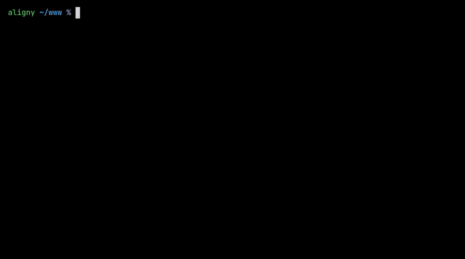

[](https://cecil.app)

A simple and powerful content-driven static site generator.

[](https://github.com/Cecilapp/Cecil/releases/latest)
[](https://github.com/Cecilapp/Cecil/blob/main/LICENSE)  

Cecil is a command-line PHP application that merges [Markdown](docs/content/3-markdown.md) pages, media and [Twig](https://twig.symfony.com) templates to generate a [static website](https://en.wikipedia.org/wiki/Static_web_page).

🌐 [Website](https://cecil.app) &middot; 📄 [Documentation](https://cecil.app/documentation/) &middot; 🎨 [Themes](https://cecil.app/themes/) &middot; ✨ [Showcase](https://cecil.app/showcase/) &middot; 📰 [News](https://cecil.app/news/) &middot; 🐛 [Issues](https://github.com/Cecilapp/Cecil/issues) &middot; 💬 [Discussions](https://github.com/Cecilapp/Cecil/discussions)



[](https://github.com/Cecilapp/Cecil/actions/workflows/continuous-integration.yml)
[](https://github.com/Cecilapp/Cecil/actions/workflows/release.yml)
[](https://github.com/Cecilapp/Cecil/actions/workflows/documentation.yml)  
[](https://app.codacy.com/gh/Cecilapp/Cecil/dashboard)
[](https://coveralls.io/github/Cecilapp/Cecil?branch=main)
[](https://styleci.io/repos/12738012)

## Features

- **Fast & secure**: no database, no server-side code, static files offer a minimal attack surface
- **Files only**: content is stored in flat [Markdown](docs/content/3-markdown.md) files with a [front matter](docs/content/2-front-matter.md)
- **Customizable**: powered by [Twig](docs/templates/index.md) templates, with [themes](https://cecil.app/themes/) support
- **Multiple generators**: pagination, taxonomies, sitemap, RSS feeds, robots.txt and redirects are generated automatically
- **Image optimization**: [responsive images](docs/assets/1-images.md), WebP and AVIF conversion, compression
- **Assets processing**: [compile, minify and fingerprint](docs/assets/2-processing.md) CSS and JavaScript
- **Multilingual**: [content localization](docs/content/4-multilingual.md) and [template translation](docs/templates/5-localization.md)
- **SEO-friendly**: meta tags, Open Graph, X (Twitter) cards and structured data
- **No installation**: download a single file and run it with PHP
- **Easy to deploy**: in minutes on [Netlify, Vercel, statichost and others](docs/deploy/index.md)
- **Open source**: licensed under EUPL-1.2 and developed on GitHub

## Quick Start

Requirements: [PHP](https://www.php.net) 8.3+ and a terminal.

1. **Download Cecil**

   ```bash
   curl -LO https://github.com/Cecilapp/Cecil/releases/latest/download/cecil.phar
   ```

2. **Create a new site** (in an empty directory containing `cecil.phar`)

   ```bash
   php cecil.phar new:site
   ```

3. **Add a page**, then edit it in `pages/`

   ```bash
   php cecil.phar new:page
   ```

4. **Preview** at `http://localhost:8000`

   ```bash
   php cecil.phar serve
   ```

5. **Build** and copy the content of the `_site` directory to any web server

   ```bash
   php cecil.phar build
   ```

Read the [Quick Start](docs/getting-started/1-quick-start.md) documentation page for more details.

Or start from a [starter kit](docs/getting-started/4-starter-kits.md) and deploy a ready-to-use blog in one click:  
[](https://cecil.app/hosting/netlify/deploy/) [](https://cecil.app/hosting/vercel/deploy/)

## Installation

Download `cecil.phar` from your terminal:

```bash
curl -LO https://github.com/Cecilapp/Cecil/releases/latest/download/cecil.phar
```

Other installation methods:

- [Homebrew](https://brew.sh): `brew install cecilapp/tap/cecil`
- [Scoop](https://scoop.sh): `scoop install https://cecil.app/scoop/cecil.json`
- [Standalone binaries](https://github.com/Cecilapp/Cecil/releases/latest) (no PHP required): `cecil-linux-x64`, `cecil-macos-arm64`, `cecil-windows-x64.exe`, etc.
- [Download page](https://cecil.app/download/) (all releases)

See the [Installation](docs/getting-started/2-installation.md) documentation page.

## Usage

Common commands:

```bash
php cecil.phar help      # Get help
php cecil.phar new:site  # Create a new website
php cecil.phar new:page  # Create a new page
php cecil.phar serve     # Preview your website locally
php cecil.phar build     # Build your website
php cecil.phar doctor    # Diagnose your site configuration
```

See the [Commands](docs/commands/index.md) documentation page.

## Contributing

See [Contributing](CONTRIBUTING.md).

Thanks goes to these wonderful people:

<!-- ALL-CONTRIBUTORS-LIST:START - Do not remove or modify this section -->
<!-- prettier-ignore-start -->
<!-- markdownlint-disable -->
<table>
  <tbody>
    <tr>
      <td align="center" valign="top" width="16.66%"><a href="https://ligny.fr"><br /><sub><b>Arnaud Ligny</b></sub></a><br /><a href="https://github.com/Cecilapp/Cecil/issues?q=author%3AArnaudLigny" title="Bug reports">🐛</a> <a href="https://github.com/Cecilapp/Cecil/commits?author=ArnaudLigny" title="Documentation">📖</a> <a href="#ideas-ArnaudLigny" title="Ideas, Planning, & Feedback">🤔</a> <a href="#maintenance-ArnaudLigny" title="Maintenance">🚧</a> <a href="#promotion-ArnaudLigny" title="Promotion">📣</a> <a href="#question-ArnaudLigny" title="Answering Questions">💬</a> <a href="https://github.com/Cecilapp/Cecil/pulls?q=is%3Apr+reviewed-by%3AArnaudLigny" title="Reviewed Pull Requests">👀</a> <a href="#translation-ArnaudLigny" title="Translation">🌍</a> <a href="#talk-ArnaudLigny" title="Talks">📢</a></td>
      <td align="center" valign="top" width="16.66%"><a href="https://frank.taillandier.me"><br /><sub><b>Frank Taillandier</b></sub></a><br /><a href="https://github.com/Cecilapp/Cecil/commits?author=DirtyF" title="Documentation">📖</a> <a href="#ideas-DirtyF" title="Ideas, Planning, & Feedback">🤔</a> <a href="#promotion-DirtyF" title="Promotion">📣</a> <a href="#translation-DirtyF" title="Translation">🌍</a> <a href="#mentoring-DirtyF" title="Mentoring">🧑‍🏫</a></td>
      <td align="center" valign="top" width="16.66%"><a href="https://mirell.com"><br /><sub><b>Martin Szulecki</b></sub></a><br /><a href="https://github.com/Cecilapp/Cecil/issues?q=author%3AFunkyM" title="Bug reports">🐛</a> <a href="https://github.com/Cecilapp/Cecil/commits?author=FunkyM" title="Code">💻</a> <a href="#ideas-FunkyM" title="Ideas, Planning, & Feedback">🤔</a></td>
      <td align="center" valign="top" width="16.66%"><a href="https://www.magentix.fr"><br /><sub><b>Matthieu Vion</b></sub></a><br /><a href="https://github.com/Cecilapp/Cecil/issues?q=author%3Amagentix" title="Bug reports">🐛</a> <a href="https://github.com/Cecilapp/Cecil/commits?author=magentix" title="Code">💻</a></td>
      <td align="center" valign="top" width="16.66%"><a href="https://github.com/peter279k"><br /><sub><b>Chun-Sheng, Li</b></sub></a><br /><a href="https://github.com/Cecilapp/Cecil/commits?author=peter279k" title="Code">💻</a> <a href="#security-peter279k" title="Security">🛡️</a></td>
      <td align="center" valign="top" width="16.66%"><a href="https://www.benjaminhirsch.net"><br /><sub><b>Benjamin Hirsch</b></sub></a><br /><a href="https://github.com/Cecilapp/Cecil/issues?q=author%3Abenjaminhirsch" title="Bug reports">🐛</a> <a href="https://github.com/Cecilapp/Cecil/commits?author=benjaminhirsch" title="Code">💻</a></td>
    </tr>
    <tr>
      <td align="center" valign="top" width="16.66%"><a href="http://kavlak.uk/@ahnlak"><br /><sub><b>Pete Favelle</b></sub></a><br /><a href="https://github.com/Cecilapp/Cecil/issues?q=author%3Aahnlak" title="Bug reports">🐛</a> <a href="https://github.com/Cecilapp/Cecil/commits?author=ahnlak" title="Code">💻</a> <a href="#ideas-ahnlak" title="Ideas, Planning, & Feedback">🤔</a></td>
      <td align="center" valign="top" width="16.66%"><a href="https://backendtea.com"><br /><sub><b>Gert de Pagter</b></sub></a><br /><a href="https://github.com/Cecilapp/Cecil/issues?q=author%3ABackEndTea" title="Bug reports">🐛</a> <a href="#infra-BackEndTea" title="Infrastructure (Hosting, Build-Tools, etc)">🚇</a></td>
      <td align="center" valign="top" width="16.66%"><a href="https://aboutweb.dev"><br /><sub><b>Joe Vallender</b></sub></a><br /><a href="https://github.com/Cecilapp/Cecil/issues?q=author%3Ajoevallender" title="Bug reports">🐛</a></td>
      <td align="center" valign="top" width="16.66%"><a href="https://jawira.com/"><br /><sub><b>Jawira Portugal</b></sub></a><br /><a href="https://github.com/Cecilapp/Cecil/issues?q=author%3Ajawira" title="Bug reports">🐛</a></td>
      <td align="center" valign="top" width="16.66%"><a href="https://ouuan.moe/about"><br /><sub><b>Yufan You</b></sub></a><br /><a href="#security-ouuan" title="Security">🛡️</a></td>
      <td align="center" valign="top" width="16.66%"><a href="https://blog.welcomattic.com"><br /><sub><b>Mathieu Santostefano</b></sub></a><br /><a href="https://github.com/Cecilapp/Cecil/commits?author=welcoMattic" title="Documentation">📖</a> <a href="https://github.com/Cecilapp/Cecil/issues?q=author%3AwelcoMattic" title="Bug reports">🐛</a></td>
    </tr>
    <tr>
      <td align="center" valign="top" width="16.66%"><a href="https://github.com/maxalmonte14"><br /><sub><b>Max</b></sub></a><br /><a href="https://github.com/Cecilapp/Cecil/commits?author=maxalmonte14" title="Documentation">📖</a></td>
      <td align="center" valign="top" width="16.66%"><a href="https://lefevre.dev"><br /><sub><b>Progi1984</b></sub></a><br /><a href="https://github.com/Cecilapp/Cecil/commits?author=Progi1984" title="Code">💻</a> <a href="#ideas-Progi1984" title="Ideas, Planning, & Feedback">🤔</a></td>
      <td align="center" valign="top" width="16.66%"><a href="https://franck.matsos.dev"><br /><sub><b>Franck Matsos</b></sub></a><br /><a href="https://github.com/Cecilapp/Cecil/commits?author=fmatsos" title="Code">💻</a></td>
      <td align="center" valign="top" width="16.66%"><a href="https://odolbeau.fr/"><br /><sub><b>Olivier Dolbeau</b></sub></a><br /><a href="https://github.com/Cecilapp/Cecil/commits?author=odolbeau" title="Code">💻</a></td>
    </tr>
  </tbody>
</table>

<!-- markdownlint-restore -->
<!-- prettier-ignore-end -->

<!-- ALL-CONTRIBUTORS-LIST:END -->

This project follows the [all-contributors](https://github.com/all-contributors/all-contributors) specification ([emoji key](https://allcontributors.org/en/reference/emoji-key/)). Contributions of any kind welcome!

```bash
npm install -g all-contributors-cli
npx all-contributors add
npx all-contributors generate
```

## Development

Install dependencies:

```bash
composer install
```

Run all quality checks:

```bash
composer code
```

Run individual checks:

```bash
composer code:analyse
composer code:style
composer test
composer test:cli
```

### Build PHAR

Build the PHAR file (`dist/cecil.phar`) with [Box](https://github.com/box-project/box/):

```bash
# Install Box globally
composer global require humbug/box
export PATH=~/.composer/vendor/bin:$PATH
# Build the PHAR file
composer run build:phar
```

### Build standalone binaries

Build standalone binaries (`dist/build/`) from the PHAR file with [phpacker](https://github.com/phpacker/phpacker):

```bash
# Install phpacker globally
composer global require phpacker/phpacker
export PATH=~/.composer/vendor/bin:$PATH
# Build the PHAR file first (see above), then the binaries
composer run build:phar
composer run build:package
```

> phpacker requires the PHP `zip` extension and enough memory to load each PHP binary (~80 MB): set `memory_limit = -1` if the build stops with an "Allowed memory size exhausted" error.

### Build API documentation

Build the API documentation with [phpDocumentor](https://www.phpdoc.org):

```bash
# Download phpDocumentor PHAR
curl -Lo phpdoc https://phpdoc.org/phpDocumentor.phar
# Build the API documentation
php phpdoc
```

### Release

To release a new version, create a new Git tag with the version number (e.g. `1.0.0`), push it to GitHub and the release will be automatically published by GitHub Actions.

```bash
git tag 1.0.0
git push origin 1.0.0
```

> [!TIP]
> To create a **pre-release**, add a suffix to the version number (e.g. `1.0.0-beta.1`).

The automated workflow also will publish the release to the [website](https://cecil.app/download), update the [Homebrew formula](https://github.com/Cecilapp/homebrew-tap) and the [Scoop manifest](https://cecil.app/scoop/cecil.json).

## AI agent skill

Cecil ships with an [agent skill](skills/cecil/SKILL.md) that teaches AI coding agents (GitHub Copilot, Claude Code, Cursor, etc.) how to build and configure Cecil sites, and a [theme skill](skills/cecil-theme/SKILL.md) dedicated to creating and packaging Cecil themes.

Install them with the [GitHub CLI](https://cli.github.com):

```bash
gh skill install cecilapp/cecil
```

Or with [`npx skills`](https://www.skills.sh):

```bash
npx skills add cecilapp/cecil
```

Or, with [Claude Code](https://code.claude.com), as a plugin:

```text
/plugin marketplace add Cecilapp/claude-plugins
/plugin install cecil@cecil
```

Once installed, ask your agent to create, build, configure, or deploy a Cecil site and it will use the skill automatically.

See the [AI documentation](https://cecil.app/documentation/ai/) for more details, including how to generate a `llms.txt` file and Markdown versions of your pages.

## Sponsors

[](https://aperturelab.fr "Aperture Lab")&nbsp;&nbsp;&nbsp;&nbsp;&nbsp;&nbsp;&nbsp;&nbsp;
[](https://studio.cecillie.fr#gh-light-mode-only "studio cecillie")[](https://studio.cecillie.fr#gh-dark-mode-only "studio cecillie")&nbsp;&nbsp;&nbsp;&nbsp;&nbsp;&nbsp;&nbsp;&nbsp;[](https://www.netlify.com#gh-light-mode-only "Netlify")[](https://www.netlify.com#gh-dark-mode-only "Netlify")

## License

Cecil is a free software licensed under the [EUPL-1.2](https://interoperable-europe.ec.europa.eu/collection/eupl/eupl-text-eupl-12) license.

The Cecil documentation is available under the [Creative Commons Attribution 4.0](https://creativecommons.org/licenses/by/4.0/deed) license.

Libraries used by Cecil are subject to their respective licenses (run `composer licenses`).

Cecil © [Arnaud Ligny](https://arnaudligny.fr)  
Logo © [Cécile Ricordeau](https://www.cecillie.fr)
