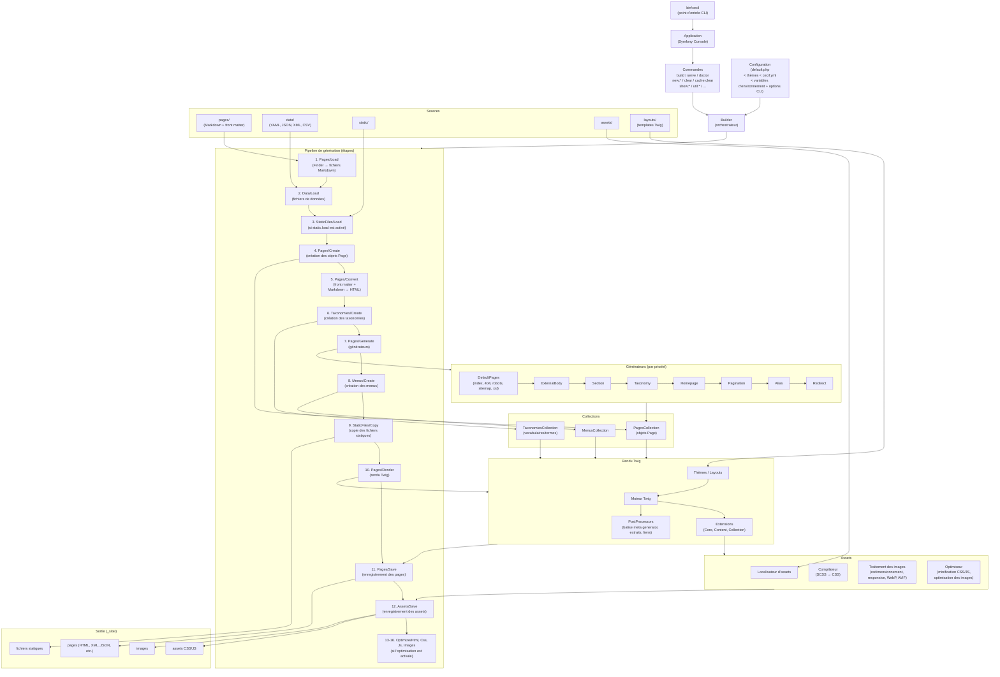

<!--
title: "Architecture"
description: "Diagramme du processus de génération et composants clés."
date: 2026-05-27
updated: 2026-10-19
alias: documentation/architecture
path: documentation/developpeurs/architecture
-->
# Architecture

Cette page présente une vue d’ensemble du pipeline de génération de Cecil et de ses composants clés.

## Diagramme

## Composants clés

| Composant           | Rôle                                                                                                                     |
|---------------------|--------------------------------------------------------------------------------------------------------------------------|
| **Builder**         | Orchestrateur central, exécute les étapes en séquence                                                                    |
| **Config**          | Fusionne la configuration par défaut, des thèmes et du projet (`Config\Merger`), les variables d’environnement (`CECIL_*`) et les options CLI, et signale les options dépréciées (`Config\Deprecations`) |
| **Steps**           | Pipeline modulaire (16 étapes), chacune avec `init()` / `canProcess()` / `process()`                                     |
| **Collections**     | Pages, Taxonomies, Menus : structures de données centrales                                                               |
| **Generators**      | Créent ou mettent à jour des pages (pages par défaut, sections, taxonomies, pagination, alias, redirections, etc.)       |
| **Renderer (Twig)** | Applique les templates + extensions + post-processeurs                                                                   |
| **Assets**          | Créés depuis les templates : compilent le SCSS, minifient, redimensionnent et convertissent les images, ajoutent une empreinte aux fichiers |
