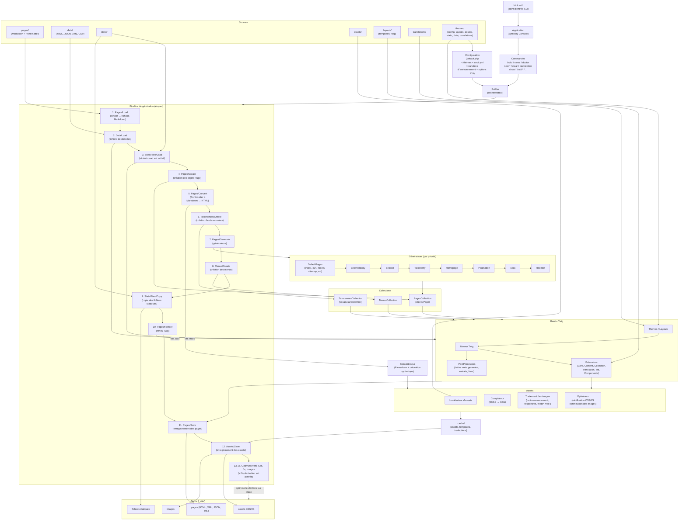
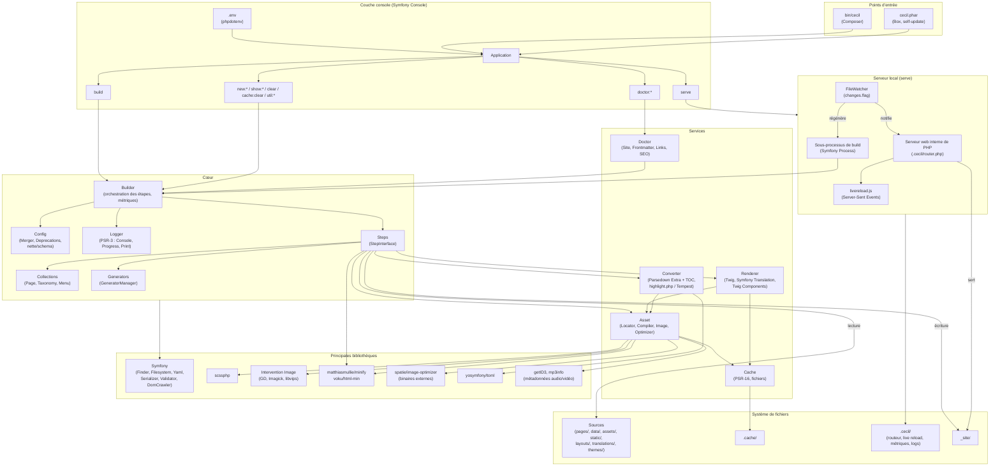

<!--
title: "Architecture"
description: "Diagrammes du pipeline de génération et de l’architecture technique, et composants clés."
date: 2026-05-27
updated: 2026-10-26
alias: documentation/architecture
path: documentation/developpeurs/architecture
-->
# Architecture

Cette page présente une vue d’ensemble du pipeline de génération de Cecil, de son architecture technique et de ses composants clés.

## Pipeline de génération

## Architecture technique

Le diagramme ci-dessous montre l’organisation du code en couches, de la ligne de commande jusqu’au système de fichiers, ainsi que les bibliothèques sur lesquelles s’appuie chaque composant.

## Composants clés

| Composant           | Rôle                                                                                                                     |
|---------------------|--------------------------------------------------------------------------------------------------------------------------|
| **Builder**         | Orchestrateur central, exécute les étapes en séquence                                                                    |
| **Config**          | Fusionne la configuration par défaut, des thèmes et du projet (`Config\Merger`), les variables d’environnement (`CECIL_*`) et les options CLI, et signale les options dépréciées (`Config\Deprecations`) |
| **Steps**           | Pipeline modulaire (16 étapes), chacune avec `init()` / `canProcess()` / `process()`                                     |
| **Collections**     | Pages, Taxonomies, Menus : structures de données centrales                                                               |
| **Converter**       | Analyse le front matter (YAML, INI, TOML ou JSON) et convertit le Markdown en HTML (Parsedown, coloration syntaxique)    |
| **Generators**      | Créent ou mettent à jour des pages (pages par défaut, sections, taxonomies, pagination, alias, redirections, etc.)       |
| **Extensions**      | Générateurs, extensions Twig, post-processeurs et abonnés aux événements déclarés par nom, chargés et validés par `Extension\Loader` |
| **Events**          | Événements de build (`Event\BuildEvents`) déclenchés autour du build, de chaque étape et du cycle de vie de chaque page, pour [étendre Cecil](1-extend.fr.md#evenements-de-build) |
| **Renderer (Twig)** | Applique les templates + extensions + post-processeurs                                                                   |
| **Assets**          | Créés depuis le contenu Markdown et les templates : compilent le SCSS, minifient, redimensionnent et convertissent les images, ajoutent une empreinte aux fichiers |
| **Cache**           | Stocke les assets traités, les templates compilés et les traductions dans `.cache/` pour accélérer les builds suivants   |
| **Doctor**          | Diagnostique le projet : front matter, liens, SEO, cache (commandes `doctor`)                                            |
