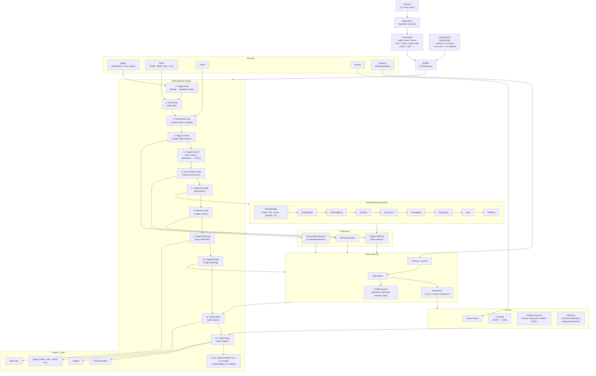

<!--
title: "Architecture"
description: "Diagram of the build pipeline and key components."
date: 2026-05-27
updated: 2026-10-18
alias: documentation/architecture
-->
# Architecture

This page gives an overview of Cecil’s build pipeline and its key components.

## Diagram

## Key components

| Component           | Role                                                                                                     |
|---------------------|----------------------------------------------------------------------------------------------------------|
| **Builder**         | Central orchestrator that executes steps in sequence                                                     |
| **Config**          | Merges base + default + themes + project configuration, environment variables (`CECIL_*`) and CLI options |
| **Steps**           | Modular pipeline (16 steps), each with `init()` / `canProcess()` / `process()`                           |
| **Collections**     | Pages, Taxonomies, Menus: core data structures                                                           |
| **Generators**      | Create or update pages (default pages, sections, taxonomies, pagination, aliases, redirects, etc.)       |
| **Renderer (Twig)** | Applies templates + extensions + post-processors                                                         |
| **Assets**          | Created from templates: compiles SCSS, minifies, resizes and converts images, fingerprints files         |
