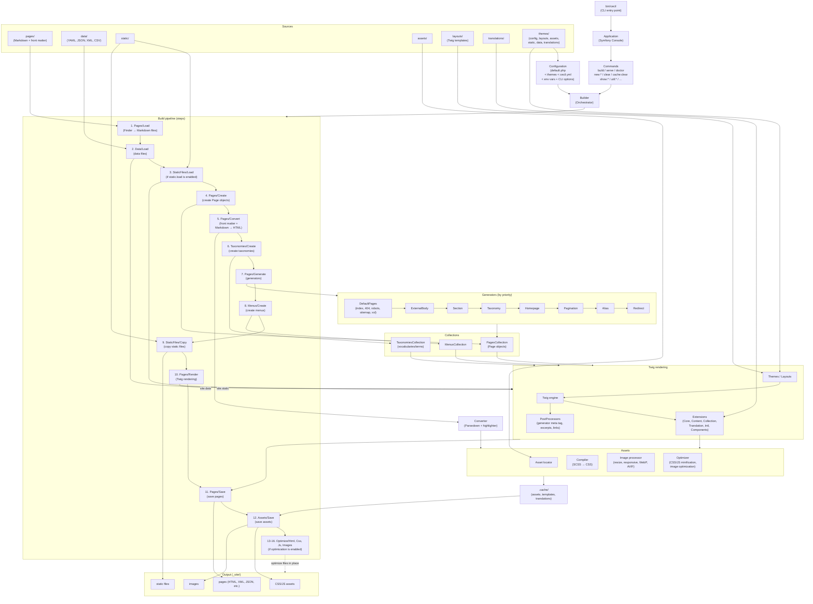
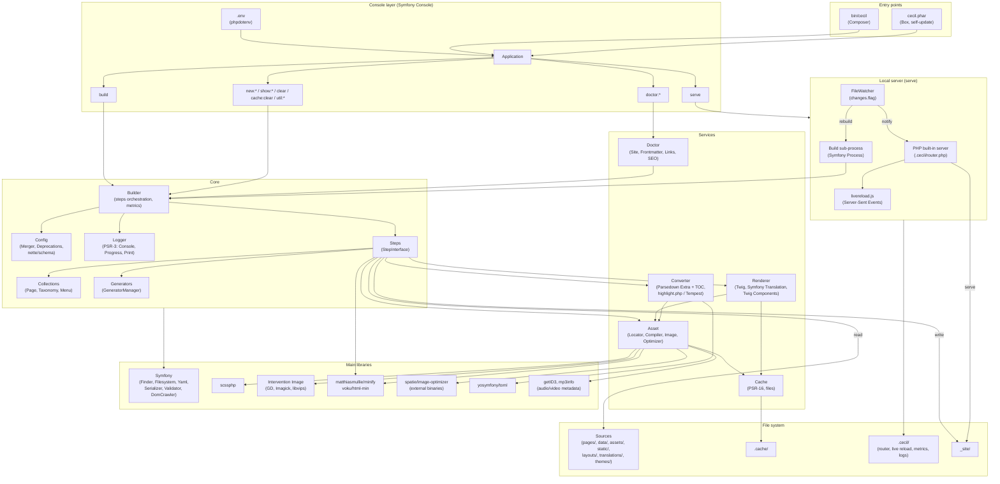

<!--
title: "Architecture"
description: "Diagrams of the build pipeline and of the technical architecture, and key components."
date: 2026-05-27
updated: 2026-10-26
alias: documentation/architecture
-->
# Architecture

This page gives an overview of Cecil’s build pipeline, its technical architecture and its key components.

## Build pipeline

## Technical architecture

The diagram below shows how the code is organized in layers, from the command line to the file system, and which libraries each component relies on.

## Key components

| Component           | Role                                                                                                     |
|---------------------|----------------------------------------------------------------------------------------------------------|
| **Builder**         | Central orchestrator that executes steps in sequence                                                     |
| **Config**          | Merges default, themes and project configuration (`Config\Merger`), environment variables (`CECIL_*`) and CLI options, and reports deprecated options (`Config\Deprecations`) |
| **Steps**           | Modular pipeline (16 steps), each with `init()` / `canProcess()` / `process()`                           |
| **Collections**     | Pages, Taxonomies, Menus: core data structures                                                           |
| **Converter**       | Parses the front matter (YAML, INI, TOML or JSON) and converts Markdown to HTML (Parsedown, code highlighting) |
| **Generators**      | Create or update pages (default pages, sections, taxonomies, pagination, aliases, redirects, etc.)       |
| **Extensions**      | Generators, Twig extensions, post-processors and event subscribers declared by name, loaded and validated by `Extension\Loader` |
| **Events**          | Build events (`Event\BuildEvents`) dispatched around the build, each step and each page lifecycle, to [extend Cecil](1-extend.md#build-events) |
| **Renderer (Twig)** | Applies templates + extensions + post-processors                                                         |
| **Assets**          | Created from Markdown content and templates: compiles SCSS, minifies, resizes and converts images, fingerprints files |
| **Cache**           | Stores processed assets, compiled templates and translations in `.cache/` to speed up subsequent builds  |
| **Doctor**          | Diagnoses the project: front matter, links, SEO, cache (`doctor` commands)                               |
